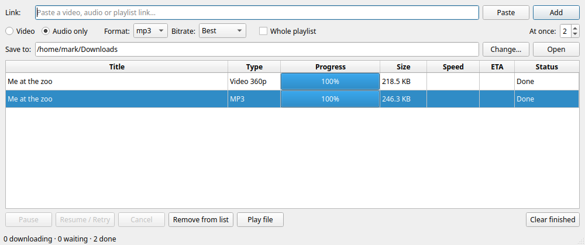

# Wavefall Media Downloader

A desktop app for downloading video and audio from YouTube, SoundCloud, Bandcamp and
[many other sites](https://github.com/yt-dlp/yt-dlp/blob/master/supportedsites.md).
Built with [yt-dlp](https://github.com/yt-dlp/yt-dlp) and Qt (PySide6).



## Features

- Download queue with pause, resume, cancel and retry
- Video up to 4K, or audio only as MP3, M4A or Opus
- Separate save folders for video and audio
- Optional subtitles, embedded in the video
- Audio files named `Artist - Song`
- Playlist support: preview a playlist and choose which items to download
- Several downloads at once
- Update notifications for the app and yt-dlp

## Requirements

- Linux (tested on Linux Mint 22 and Ubuntu 24.04)
- Python 3.10 or newer
- git, ffmpeg, python3-venv
- [Deno](https://deno.com) or Node.js 20+ (needed for YouTube)

## Installation

Install the system packages:

```bash
sudo apt install git ffmpeg python3-venv unzip
```

Install Deno, if you don't already have Deno or Node.js 20+:

```bash
curl -fsSL https://deno.land/install.sh | sh
```

Download and set up the app:

```bash
git clone https://github.com/MarkFergus/wavefall-media-downloader.git ~/Applications/wavefall-media-downloader
cd ~/Applications/wavefall-media-downloader
./setup.sh
```

Then open **Wavefall Media Downloader** from your applications menu, or run `./run.sh`.

## Usage

1. Paste a link and choose **Video** or **Audio**.
2. Pick the quality or audio format. For video, tick **Subtitles** to include them.
3. Click **Add**. The download starts straight away.

Tick **Whole playlist** to download every item in a playlist. Double-click a finished
download to play it, or right-click it for more options.

## Updating

The app checks for updates when it starts and shows **Update now** when one is available.
To update manually:

```bash
~/Applications/wavefall-media-downloader/update.sh
```

If downloads from a site stop working, updating usually fixes it.

## Uninstalling

```bash
rm -rf ~/Applications/wavefall-media-downloader
rm -f ~/.local/share/applications/wavefall-media-downloader.desktop
rm -f ~/.local/share/icons/hicolor/*/apps/wavefall-media-downloader.*
rm -rf ~/.local/share/wavefall-media-downloader ~/.config/wavefall-media-downloader
```

## License

[MIT](LICENSE)
